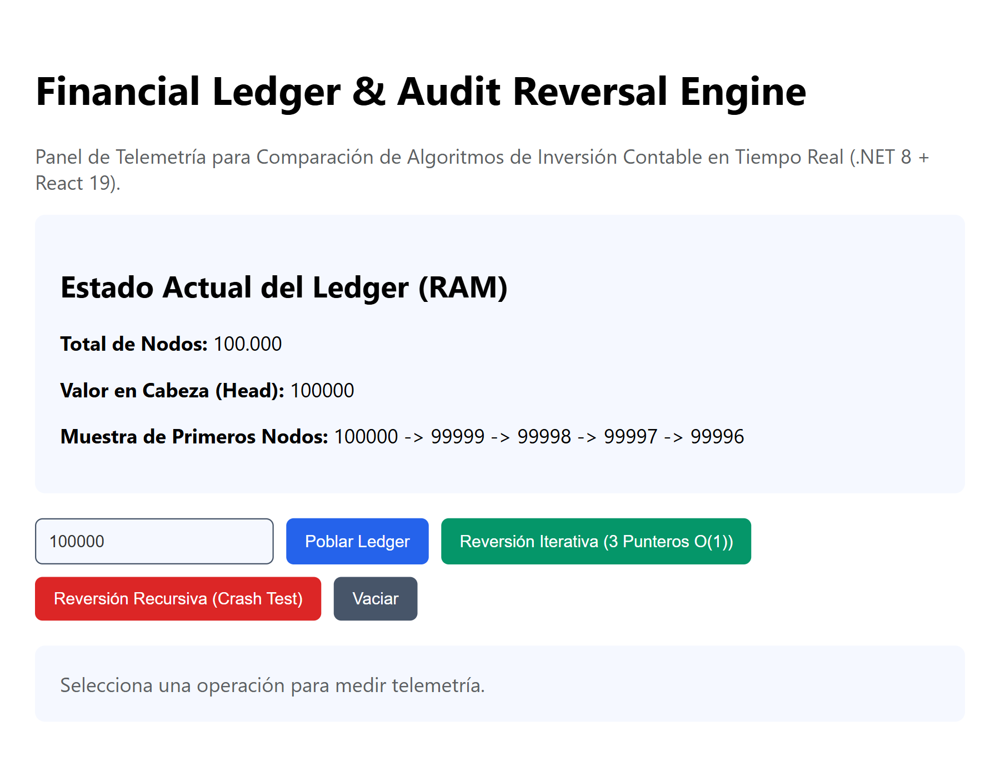
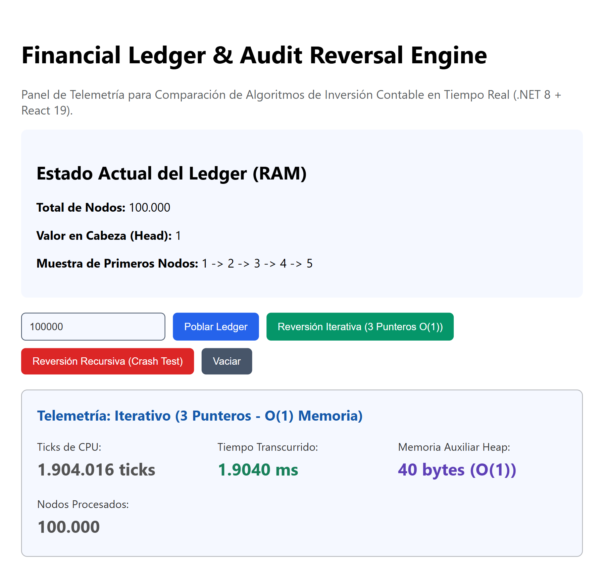
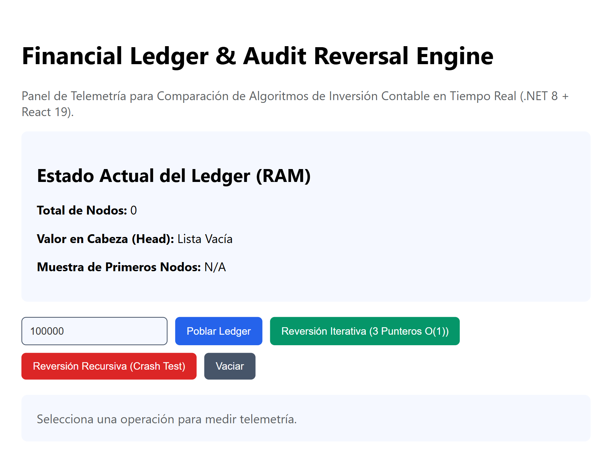

# Financial Transaction Ledger & Audit Reversal Engine

[](https://dotnet.microsoft.com/)
[](https://react.dev/)
[](https://www.typescriptlang.org/)
[](https://www.docker.com/)
[](https://clean-architecture.org/)

Un motor de auditoría contable y reversión de lotes transaccionales de alto rendimiento diseñado en **.NET 8 (C# 12)** y **React 19 (TypeScript)**.

El proyecto resuelve un problema crítico de desbordamiento de memoria (_Stack Overflow_) producido por llamadas recursivas en estructuras de datos de tipo lista enlazada contable, refactorizándolo hacia un algoritmo **iterativo de 3 punteros** in-place con espacio auxiliar constante **$\mathcal{O}(1)$**.

---

## 📸 Demostración Visual del Sistema

### 1. Poblar el Ledger

Inicialización en RAM de $100,000$ nodos transaccionales inmutables ordenados cronológicamente.


### 2. Reversión Iterativa Segura $\mathcal{O}(1)$

Reorganización de enlaces de memoria en tiempo constante sin consumo adicional de pila de llamadas (Call Stack).


### 3. Simulación de Falla Recursiva (Crash Test)

Demostración controlada del colapso por `System.StackOverflowException` provocado por la acumulación de $100,000$ marcos de llamada en el servidor.


### 4. Vaciado del Ledger

Reinicio y liberación de memoria RAM gestionada por el Garbage Collector de .NET.


---

## 🛠️ Arquitectura y Tecnologías

### Backend

- **.NET 8 / C# 12**: Clean Architecture (Domain, Services, Api).
- **Inyección de Dependencias**: Servicio Singleton para mantener el estado del Ledger en memoria RAM sin persistencia en disco.
- **Telemetría de CPU**: Medición precisa de tiempo mediante ciclo de reloj del hardware (`Stopwatch.ElapsedTicks`) y auditoría de memoria asignada por hilo (`GC.GetAllocatedBytesForCurrentThread`).
- **xUnit**: Suite de pruebas unitarias automatizadas.

### Frontend

- **React 19 + TypeScript**: Interfaz reactiva e inmutable.
- **Vite + pnpm**: Empaquetado rápido y gestión eficiente de dependencias.

### Infraestructura

- **Docker Multi-Stage**: Compilación aislada para producción.
- **Docker Compose**: Orquestación simplificada de servicios (Backend + Nginx para Frontend).

---

## ⚡ Complejidad Algorítmica

| Algoritmo                  | Complejidad Temporal |      Complejidad Espacial       |        Estabilidad ($100k$ nodos)         |
| :------------------------- | :------------------: | :-----------------------------: | :---------------------------------------: |
| **Recursivo (Legacy)**     |   $\mathcal{O}(N)$   | $\mathcal{O}(N)$ _(Call Stack)_ | ❌ **Colapso (`StackOverflowException`)** |
| **Iterativo (3 Punteros)** |   $\mathcal{O}(N)$   | $\mathcal{O}(1)$ _(Heap/Stack)_ | ✅ **Seguro (Tiempos $< 10\text{ ms}$)**  |

---

## 🚀 Guía de Instalación y Ejecución

### Prerrequisitos

- [Docker Desktop](https://www.docker.com/products/docker-desktop/) instalado y en ejecución.
- _(Opcional para desarrollo local)_: [.NET 8 SDK](https://dotnet.microsoft.com/download/dotnet/8.0) y [Node.js](https://nodejs.org/) con `pnpm`.

### Opción A: Despliegue Inmediato con Docker Compose (Recomendado)

```bash
# 1. Clonar el repositorio
git clone https://github.com/tu-usuario/financial-ledger-engine.git
cd financial-ledger-engine

# 2. Construir y levantar contenedores en segundo plano
docker compose up --build -d

# 3. Verificar estado de los servicios
docker compose ps
```

- **Frontend Dashboard**: Acceder a `http://localhost:8080`
- **Backend API**: Acceder a `http://localhost:5171/swagger`

Para detener los servicios:

```bash
docker compose down
```

---

### Opción B: Ejecución en Entorno Local de Desarrollo

#### 1. Levantar el Backend (.NET 8)

```bash
cd backend
dotnet restore
dotnet run --project FinancialLedgerEngine.Api/FinancialLedgerEngine.Api.csproj
```

_API escuchando en `http://localhost:5171`_

#### 2. Correr las Pruebas Unitarias

```bash
cd backend
dotnet test
```

#### 3. Levantar el Frontend (React + Vite)

```bash
cd frontend
pnpm install
pnpm dev
```

_Dashboard disponible en `http://localhost:5173`_

---

## 📋 Endpoints de la API REST

| Método | Endpoint                                | Descripción                                                               |
| :----- | :-------------------------------------- | :------------------------------------------------------------------------ |
| `GET`  | `/api/ledger/state`                     | Devuelve el total de nodos, valor en la cabeza (Head) y muestra de datos. |
| `POST` | `/api/ledger/populate?count=100000`     | Crea $N$ nodos contables en la memoria RAM.                               |
| `POST` | `/api/ledger/reverse?useIterative=true` | Revierte la lista contable e informa la telemetría de ejecución.          |
| `POST` | `/api/ledger/reset`                     | Reinicia y vacía la lista enlazada en RAM.                                |

---

## 📑 Documentación Técnica Extendida

Para profundizar en las decisiones de diseño de software, análisis del Call Stack, gestión de punteros y arquitectura detallada, consulte el archivo [`DOCUMENTACION.md`](./DOCUMENTACION.md).
